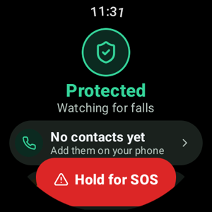
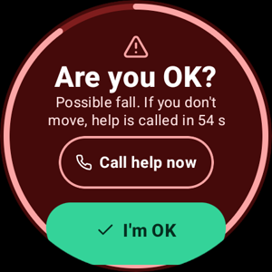
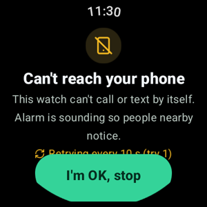
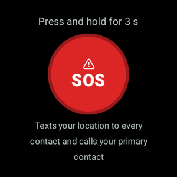

# FallGuard Watch

Fall detection for Wear OS. The watch notices a hard fall, asks if you're OK, and if you don't answer, your phone texts your emergency contacts a Google Maps link and calls the first one.


[Watch the demo with sound (MP4)](docs/media/fallguard-watch-demo.mp4). The screens in the video are the real app running in the Wear OS emulator; the fall is simulated with emulator sensor data.

This is a fork of [kushagr-tech/fall_detection](https://github.com/kushagr-tech/fall_detection), a phone app that detects falls from a phone in your pocket. This fork moves detection to the wrist and keeps the phone app as the part that sends help. The original phone app's documentation is in [docs/phone-app.md](docs/phone-app.md).

> FallGuard is a prototype. It is not a medical device, it has been tested on one wearer with simulated falls, and it should not replace a certified alert service for someone at risk.

| Watching | Possible fall | Phone out of reach | Hold for SOS |
|:---:|:---:|:---:|:---:|
|  |  |  |  |

## What it does

The watch app, FallGuard Watch, reads the watch's accelerometer and gyroscope 50 times a second in the background, with the screen off. A small CNN+LSTM model trained on wrist data runs every 0.4 seconds, and a detector checks for an impact, a fast rotation and the model's verdict together.

When all three line up, the watch vibrates and shows "Are you OK?". Tapping I'm OK ends it. If you stay almost completely still for 60 seconds, or tap Call help now, the watch asks the phone to send the SOS. You can also send an SOS yourself by holding the SOS button for 3 seconds, which avoids presses by accident.

The phone app, FallGuard Companion, does the sending. A Galaxy Watch4 Classic has no cellular radio, so the phone texts every contact a message with a Google Maps link to a fresh GPS fix and places a call to the first contact. It then tells the watch who it reached. If no phone answers, the watch sounds an alarm so people nearby notice and retries every 10 seconds.

Contacts are added on the phone. Only their names are synced to the watch; phone numbers never leave the phone.

The watch also has a Record data screen. You pick what you are about to do, such as "Normal day" or "Clapping", and the watch logs raw sensor data to a file for training. The files stay on the watch until you copy them off.

## How it works

```
Galaxy Watch (FallGuard Watch)                         Phone (FallGuard Companion)
───────────────────────────────                        ──────────────────────────────
accelerometer + gyroscope, 50 Hz
  │  capped at 4 g, like the training data
  ▼
2 s window ──► wrist model (every 0.4 s)
  │
  ▼
detector: impact + rotation + model
  │
  ▼
"Are you OK?"  ── I'm OK ──► done
  │ 60 s still, or Call help now
  ▼
SosController ── Wearable Data Layer ──►  WatchRelayService
                                            ├─ fresh GPS fix (up to 10 s)
                                            ├─ SMS with Google Maps link to every contact
                                            └─ call to the first contact
"Help is notified"  ◄──── result ───────────┘
```

Both apps share the application ID `com.shreyshrivastava.fallguard`, because the Wearable Data Layer only connects a phone app and a watch app that share an ID and signing key. That ID also lets them install next to the original FallGuard app without replacing it.

## Results

All numbers below come from the reports in [har_pipeline/outputs/wrist/](har_pipeline/outputs/wrist/). The model is tested on people it never saw during training.

| Test | Falls caught | False alarms |
|---|---|---|
| Model alone, unseen WEDA-FALL people (5-fold by person) | 98.4% | 10.2% of activity recordings |
| Model alone, UMAFall (outside dataset) | 86.1% | 13.6% of activity recordings |
| Full detector, wrist-tuned, WEDA-FALL falls | 92.9% | |
| Full detector, wrist-tuned, UMAFall | 88.5% | 5.9% of activity recordings |
| Full detector, the wearer's held-out 5.25 h day | | 8 prompts, about 24 per 16 h day |
| After the 60 s stillness step, same day | | 2 auto-calls, about 6 per 16 h day |

The false alarm rate is the main open problem. A watch that prompts 24 times a day is not ready for daily use, and 6 automatic calls a day would be worse. More days of the wearer's normal activity in training is the most likely fix.

On real hardware, a Galaxy Watch4 Classic (SM-R890) and a Galaxy S25 Ultra, the whole chain ran end to end:

| Time | Device | Event |
|---|---|---|
| 22:57:47.1 | Watch | Fall confirmed: impact 56.2 m/s², model 98% |
| 22:57:51.6 | Watch | Wearer tapped Call help now |
| 22:57:51.9 | Watch | SOS sent to the phone |
| 22:57:53.4 | Phone | SMS sent and call started to the primary contact |
| 22:57:54.5 | Watch | Phone's result received |

The recorder logged about 20.5 hours of normal wear on the same watch with one 2-second gap, at a steady 50 Hz.

## What the research changed

Before building, the plan was checked against published sources. These findings changed it:

- Health Services on Wear OS only provides processed metrics such as heart rate and steps, mostly once a second, with no raw motion data. Raw 50 Hz data has to come from `SensorManager` ([Android docs](https://developer.android.com/health-and-fitness/health-services/compatibility)).
- While the processor sleeps, a non-wake-up sensor buffer overwrites its oldest samples once it fills. The recorder and detector hold a partial wake lock to avoid gaps ([AOSP batching](https://source.android.com/docs/core/interaction/sensors/batching)).
- PyTorch Mobile is no longer actively supported ([PyTorch](https://docs.pytorch.org/tutorials/_sources/recipes/mobile_interpreter.rst.txt)). The app still uses its lite runtime for now, with the model backported to a format that runtime reads. Moving to LiteRT or ExecuTorch is planned.
- KFall, which the original pipeline loads, has no wrist sensor; its sensor is on the lower back ([Frontiers](https://www.frontiersin.org/journals/aging-neuroscience/articles/10.3389/fnagi.2021.692865/epub)).
- Wrist models trained on one public dataset and tested on another reached an F1 of only about 36 to 52% in [Sensors 2024](https://mdpi.com/1424-8220/24/5/1679), mostly from false alarms. Quickly lying down, sleeping and taking the watch off are known triggers ([PMC](https://pmc.ncbi.nlm.nih.gov/articles/PMC4934226)).
- Over Bluetooth a watch borrows the phone's internet connection but not its calling or SMS ([Android docs](https://developer.android.com/training/wearables/data-layer/network-access)), so watches without LTE need the phone to send help.

The phone app's original detector thresholds also did not transfer to the wrist. On the wrist they raised about 30 prompts a day and missed 29% of WEDA-FALL falls, because ordinary arm movement passes the phone's impact and rotation checks and a wrist keeps moving after a fall. [har_pipeline/tune_detector.py](har_pipeline/tune_detector.py) retuned them on wrist data.

## Data

| Dataset | Used for | Sensor | License |
|---|---|---|---|
| [WEDA-FALL](https://github.com/joaojtmarques/WEDA-FALL) | Training and cross-person tests | Fitbit Sense on the wrist, about 40 Hz | No license file |
| [UMAFall](https://figshare.com/articles/dataset/UMA_ADL_FALL_Dataset_zip/4214283) | Outside test only (its wrist sensor clips at 250 °/s and 8 g) | SensorTag on the wrist, 20 Hz | CC BY-NC 4.0 |
| The wearer's own recordings | Not-fall training data and the held-out day | Galaxy Watch4 Classic, 50 Hz | Private, not in this repo |

[BITS-2](https://doi.org/10.5281/zenodo.10013090) was downloaded but left out, because its timestamps are damaged in the published files.

WEDA-FALL has no license, so its data and the trained model weights are not committed to this repo. `datasets/`, `recordings/`, the `.venv/` and the model files are all git-ignored. You need to download the datasets and train the model yourself to build the watch app.

## Repository layout

```
activity_collector/
  core/   shared detector, model runner, contacts, history, Data Layer paths
  app/    FallGuard Companion (phone): relays the watch's SOS, manages contacts
  wear/   FallGuard Watch: detection service, SOS, recorder, Compose screens
har_pipeline/
  train_wrist.py         train and test the wrist model
  simulate_detector.py   replay recordings through a Python copy of the detector
  tune_detector.py       retune detector thresholds for the wrist
  export_wrist.py        export the model for the watch
tools/
  pull_recordings.sh     copy recordings off the watch
  check_recording.py     report sample rate and gaps per recording
  record_remote.sh       start or stop a recording over adb
docs/
  phone-app.md           the original phone app's documentation
```

## Build and install

You need Android Studio or the Android SDK, JDK 17, Python 3.12 and [uv](https://github.com/astral-sh/uv).

1. Train and export the model. Put WEDA-FALL in `datasets/weda-fall/repo` and UMAFall in `datasets/umafall/data`, and copy your watch recordings into `recordings/` (at least two "Normal day" sessions).

   ```bash
   uv venv .venv --python 3.12
   uv pip install --python .venv/bin/python torch numpy pandas scikit-learn
   .venv/bin/python har_pipeline/train_wrist.py
   .venv/bin/python har_pipeline/tune_detector.py
   .venv/bin/python har_pipeline/export_wrist.py
   ```

2. Build both apps.

   ```bash
   cd activity_collector
   ./gradlew :app:assembleDebug :wear:assembleDebug
   ```

3. Turn on Wireless debugging on the watch and the phone, pair each with `adb pair`, then install. On Galaxy phones, Samsung's Auto Blocker must be off while you install.

   ```bash
   adb -s <phone> install --user 0 app/build/outputs/apk/debug/app-debug.apk
   adb -s <watch> install wear/build/outputs/apk/debug/wear-debug.apk
   ```

4. Open FallGuard Companion on the phone, allow SMS, phone and location, and add at least one emergency contact. Then open FallGuard Watch and tap Resume Guard.

Test the SOS only with a contact who knows it's a test. It sends a real text and places a real call.

## Recording data

```bash
tools/record_remote.sh start "Normal day" <watch>
tools/record_remote.sh stop <watch>
tools/pull_recordings.sh <watch> recordings
python3 tools/check_recording.py recordings/*.csv
```

Each file holds every raw accelerometer and gyroscope event with its hardware timestamp. Nothing is resampled or filled in, so the checker can report real gaps. Recording takes about 20 MB per hour.

## Known limits

- False alarms are far above the target of fewer than one a day.
- The effect of the 60-second stillness step on catching real falls is unknown, because the public datasets end a few seconds after each fall.
- All results come from one wearer and from simulated falls by young people. Older people move differently.
- Only the Standard sensitivity is tuned; More sensitive and Fewer prompts are shown but disabled.
- The phone-unreachable alarm, "I'm OK, tell them", and the fresh GPS fix have not been tested on real devices yet.
- The design's watch tile is not built.

## Credits

The original FallGuard phone app, its training pipeline and its datasets work are by [kushagr-tech](https://github.com/kushagr-tech/fall_detection). The upstream repository has no license file, so ask its author before reusing that code. Icons are from [Lucide](https://lucide.dev) (ISC license).
